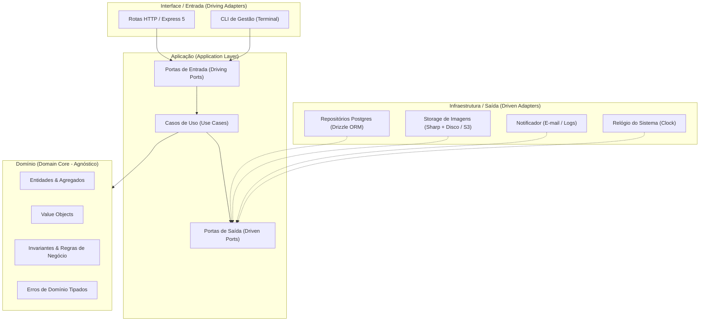
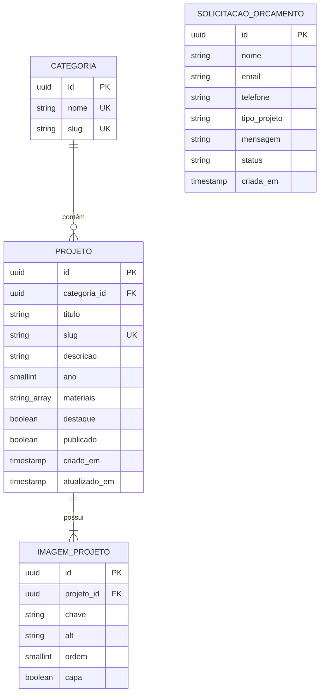

# 🪵 marceRI — Portfólio de Marcenaria Artesanal & Estudo Arquitetural

> **Uma vitrine digital para divulgação de marcenaria fina, construída como laboratório prático de engenharia de software aplicando Arquitetura Hexagonal (Ports & Adapters), Domain-Driven Design (DDD) e Clean Architecture.**

[Abrir o site](https://uservesper.github.io/marceRi/)

---

## 🎯 1. Visão Geral e Propósito de Estudo

O **marceRI** foi idealizado com dois objetivos claros e complementares:

1. **Visão de Produto:** Criar uma experiência web moderna, elegante e de alta conversão para exibir peças de marcenaria artesanal, proporcionando catálogo visual com fotos em alta resolução, filtragem por categorias e solicitação direta de orçamentos.
2. **Visão de Engenharia (Estudo de Caso):** Servir como um laboratório prático para demonstrar a aplicação rigorosa de padrões arquiteturais corporativos em um domínio conciso, sem cair na armadilha do *overengineering* (abstrações que não se pagam).

```
                      ┌────────────────────────────────────────┐
                      │            marceRI Monorepo            │
                      └──────────────────┬─────────────────────┘
                                         │
                 ┌───────────────────────┴───────────────────────┐
                 ▼                                               ▼
      ┌──────────────────────┐                       ┌──────────────────────┐
      │       apps/web       │                       │       apps/api       │
      │  React 19 + Tailwind │                       │   Node.js + Express  │
      │   Motion + UI Pura   │                       │ Hexagonal + DDD Core │
      └──────────┬───────────┘                       └───────────┬──────────┘
                 │                                               │
                 └───────────────────────┬───────────────────────┘
                                         ▼
                             ┌───────────────────────┐
                             │    packages/shared    │
                             │  Contratos & Schemas  │
                             └───────────────────────┘
```

---

## 🏛️ 2. Arquitetura do Backend

O backend adota a **Arquitetura Hexagonal (Ports & Adapters)** combinada com princípios da **Clean Architecture**. A regra de ouro é a **Regra de Dependência**: o fluxo de dependência aponta estritamente de fora para dentro. O núcleo de domínio não importa frameworks, bibliotecas de persistência nem detalhes de transporte HTTP.

### 📐 Diagrama de Camadas



### 📦 Responsabilidade das Camadas

| Camada | Diretório | Responsabilidade | Dependências |
|---|---|---|---|
| **Domínio** | `src/modules/*/domain` | Entidades puras, agregados, objetos de valor e regras invariantes. | Nenhuma biblioteca externa (TypeScript puro). |
| **Aplicação** | `src/modules/*/application` | Orquestração dos casos de uso e definição das portas de entrada e saída. | Depende apenas do Domínio. |
| **Infraestrutura** | `src/modules/*/infrastructure` | Implementação concreta das portas de saída (Drizzle ORM, Sharp, Sistema de Arquivos, etc.). | Depende de Aplicação e Domínio. |
| **Interface** | `src/modules/*/interface` | Adaptadores de entrada (Controllers HTTP, Rotas Express, Schemas de validação de borda). | Depende de Aplicação e Pacotes Compartilhados. |
| **Composition Root** | `src/main` | Ponto de inicialização onde as instâncias concretas são instanciadas e injetadas manualmente. | Conecta todas as camadas. |

### 🔌 Portas e Adaptadores em Prática

- **Portas de Entrada (Driving Ports):** Casos de uso como `ListarProjetosPublicados`, `CriarProjeto` e `PublicarProjeto`. Tanto os endpoints HTTP quanto uma interface de linha de comando (CLI) executam os mesmos casos de uso, comprovando a desacoplagem da camada de aplicação.
- **Portas de Saída (Driven Ports):** Interfaces como `ProjetoRepository`, `CategoriaRepository`, `ImageStorage` e `Notificador`. No MVP, o armazenamento de imagens é resolvido por um adaptador local (`LocalDiskImageStorage` com `sharp`); no futuro, migrar para Cloudflare R2 ou AWS S3 requer apenas criar um novo adaptador, sem alterar uma única linha do domínio.
- **Injeção de Dependências Explícita:** Dispensamos containers de IoC complexos ou mágicos (como Inversify ou NestJS). A injeção é realizada via construtores e orquestrada de forma transparente no composition root (`src/main/`).

---

## 🪵 3. Modelagem de Domínio (DDD)

### 🗣️ Linguagem Ubíqua (Ubiquitous Language)
O vocabulário de negócio do projeto é modelado em **português** no núcleo de domínio e nos casos de uso (`Projeto`, `Imagem`, `SolicitacaoOrcamento`, `Categoria`). Conceitos técnicos e padrões de software permanecem em **inglês** (`Repository`, `Controller`, `UseCase`, `Storage`).

### 🧩 Contextos Delimitados (Bounded Contexts)

```
┌─────────────────────────────────┐     ┌─────────────────────────────────┐
│     Contexto de Portfólio       │     │       Contexto de Contato       │
│  - Projeto (Agregado Raiz)      │     │  - SolicitacaoOrcamento (Raiz)  │
│  - Imagem (Entidade Filha)      │     │  - Notificação de Novo Lead     │
│  - Categoria (Entidade)         │     │  - Rate Limit & Anti-Spam       │
└─────────────────────────────────┘     └─────────────────────────────────┘
```

### 🛡️ Entidades, Invariantes e Regras de Negócio

- **Projeto (Agregado Raiz):**
  - **Identificador Único:** UUID v4 gerado pela camada de aplicação, mantendo o domínio independente do banco.
  - **Identificador Amigável (Slug):** Gerado e sanitizado a partir do título do projeto, garantindo URLs canônicas e amigáveis para SEO.
  - **Invariante de Publicação:** Um projeto só pode transicionar para o estado `publicado = true` se possuir uma categoria associada e pelo menos uma imagem cadastrada.
  - **Gestão de Capa:** No máximo uma imagem pode ser definida como capa. Se nenhuma for escolhida explicitamente, a primeira imagem da galeria assume o papel de capa automaticamente.
  - **Ordenação Contínua:** As imagens mantêm uma ordenação sequencial estrita (1..n) e podem ser reordenadas via caso de uso específico.
- **Categoria:**
  - Nome e slug únicos no sistema.
- **SolicitacaoOrcamento:**
  - Validação estrita de e-mail e formato telefônico.
  - Mensagem com tamanho delimitado entre 10 e 2000 caracteres.
  - Máquina de estados de atendimento: `nova → respondida → arquivada` (ou diretamente `nova → arquivada`).

### 💎 Value Objects (Objetos de Valor)
- `Slug`: Garante formatação minúscula, remoção de diacríticos e separação por hífens.
- `Email`: Garante validação formal do endereço eletrônico.
- `Telefone`: Sanitiza caracteres especiais e padroniza o número de contato para links diretos de WhatsApp.
- `StatusSolicitacao`: Enumera e controla as transições válidas no ciclo de vida de um pedido de orçamento.

---

## 🗄️ 4. Modelo Conceitual de Dados

O banco de dados relacional (PostgreSQL 16) reflete as fronteiras e relacionamentos estabelecidos pelo modelo de domínio:



> **Nota de Implementação:** O gerenciamento do esquema é conduzido via **Drizzle ORM**, utilizando migrations geradas automaticamente e versionadas no repositório. Índices compostos cobrem consultas frequentes (como `publicado + destaque` e `categoria_id`), além de um índice único parcial garantindo que apenas uma imagem seja marcada como capa por projeto.

---

## 💻 5. Stack Tecnológica & Justificativas

| Camada | Tecnologia | Motivação & Trade-offs |
|---|---|---|
| **Monorepo** | pnpm Workspaces | Instalações ultrarrápidas com links rígidos (hard links), economia de disco e compartilhamento nativo de tipos entre apps. |
| **Frontend** | React 19 + TypeScript + Vite | Desempenho extremo no build, suporte a metatags nativas para SEO e ecossistema maduro para SPAs de alta fidelidade. |
| **Estilização** | Tailwind CSS v4 | Nova engine baseada em CSS moderno, compilação instantânea e facilidade para tokenização de temas artesanais (madeira/pedra). |
| **Animações** | Motion (`motion/react`) | Transições fluidas de páginas, galerias com layout animado (`layoutId`), feedback háptico visual e suporte a acessibilidade (`prefers-reduced-motion`). |
| **Backend** | Node.js 20+ & Express 5 | Express 5 com suporte nativo a rotas assíncronas sem necessidade de wrappers manuais de erro. |
| **Validação** | Zod | Validação de borda (contratos HTTP e formulários) com inferência automática de tipos estáticos em TypeScript. |
| **Banco de Dados** | PostgreSQL 16 + Drizzle ORM | ORM declarativo, tipado de ponta a ponta, leve (zero overhead em tempo de execução) e com migrações SQL transparentes. |
| **Imagens** | Multer + Sharp | Pipeline de processamento que converte uploads brutos para variantes WebP responsivas (480px, 960px e 1600px). |
| **Testes** | Vitest + Testcontainers | Testes unitários com feedback instantâneo e testes de repositório rodando contra instâncias reais de Postgres via containers. |

---

## 📂 6. Estrutura do Repositório

```
marceRI/
├── apps/
│   ├── api/                     # Backend Node.js / Express 5
│   │   ├── src/
│   │   │   ├── modules/
│   │   │   │   ├── portfolio/   # Módulo de Portfólio (Domain, App, Infra, Interface)
│   │   │   │   └── contato/     # Módulo de Contato e Orçamento
│   │   │   ├── shared/          # Utilitários, Erros Base e Abstrações
│   │   │   └── main/            # Servidor HTTP e Composition Root
│   │   └── package.json
│   │
│   └── web/                     # Frontend React 19 / Vite
│       ├── src/
│       │   ├── features/        # Componentes e páginas por funcionalidade
│       │   ├── shared/          # Design System (Botões, Modais, Lightbox)
│       │   └── routes/          # Definição de rotas da aplicação
│       └── package.json
│
├── packages/
│   └── shared/                  # Pacote de contratos tipados
│       ├── src/
│       │   ├── contracts/       # DTOs e Schemas Zod de entrada/saída
│       │   └── index.ts
│       └── package.json
│
├── docker-compose.yml           # Orquestração do PostgreSQL local
├── pnpm-workspace.yaml          # Configuração de workspaces
└── tsconfig.base.json           # Configurações base do TypeScript
```

---

## 🛣️ 7. Casos de Uso & Contratos de API

### 🌐 Endpoints Públicos (Visitante / Cliente)

| Método | Rota | Caso de Uso Vinculado | Descrição |
|---|---|---|---|
| `GET` | `/api/health` | Health Check | Verifica a integridade da API e serviços dependentes. |
| `GET` | `/api/categorias` | `ListarCategorias` | Retorna categorias para navegação e filtros. |
| `GET` | `/api/projetos` | `ListarProjetosPublicados` | Vitrine de projetos com filtros por categoria e destaque. |
| `GET` | `/api/projetos/:slug` | `ObterProjetoPublicadoPorSlug`| Detalhe do móvel com galeria completa de fotos em WebP. |
| `POST` | `/api/solicitacoes` | `EnviarSolicitacaoOrcamento` | Recebe pedidos de orçamento com proteção contra spam (honeypot + rate limit). |

### 🔒 Endpoints Administrativos (Gestão Protegida via `x-api-key`)

| Método | Rota | Caso de Uso Vinculado | Descrição |
|---|---|---|---|
| `GET` | `/api/admin/projetos` | `ListarTodosProjetos` | Lista todos os projetos (incluindo rascunhos). |
| `POST` | `/api/admin/projetos` | `CriarProjeto` | Cadastra novo projeto no ateliê. |
| `PUT` | `/api/admin/projetos/:id` | `AtualizarProjeto` | Atualiza dados cadastrais, materiais e ano. |
| `DELETE` | `/api/admin/projetos/:id` | `ExcluirProjeto` | Remove projeto e seus vínculos de imagem. |
| `POST` | `/api/admin/projetos/:id/publicar` | `PublicarProjeto` | Valida invariantes e torna o projeto visível publicamente. |
| `POST` | `/api/admin/projetos/:id/despublicar` | `DespublicarProjeto` | Retorna o projeto para o estado de rascunho. |
| `POST` | `/api/admin/projetos/:id/imagens` | `AdicionarImagem` | Upload de fotos com geração automática de WebP. |
| `PUT` | `/api/admin/projetos/:id/imagens/ordem` | `ReordenarImagens` | Altera a sequência de exibição da galeria. |
| `PUT` | `/api/admin/projetos/:id/imagens/:imgId/capa` | `DefinirCapa` | Define a imagem de destaque principal. |
| `POST` | `/api/admin/categorias` | `CriarCategoria` | Cadastra novas categorias de móveis. |
| `GET` | `/api/admin/solicitacoes` | `ListarSolicitacoes` | Lista solicitações de orçamento recebidas. |
| `PATCH` | `/api/admin/solicitacoes/:id` | `AtualizarStatusSolicitacao`| Atualiza o fluxo (`nova → respondida → arquivada`). |

---

## 🧪 8. Estratégia de Testes

A suíte de testes reflete a arquitetura desacoplada, priorizando velocidade e confiabilidade:

```
                  ▲
                 / \
                /   \     E2E / Borda (Supertest)
               /-----\    Rotas HTTP & Tratamento de Erros
              /       \
             /---------\   Integração (Testcontainers)
            /           \  Repositórios Drizzle contra PostgreSQL real
           /-------------\
          /               \ Testes Unitários Puros (Vitest)
         /_________________\ Entidades, Invariantes, Casos de Uso em Memória
```

1. **Testes Unitários:** Executados com Vitest em milissegundos. Testam regras de negócio de entidades e casos de uso utilizando implementações em memória das portas (`InMemoryProjetoRepository`).
2. **Testes de Integração:** Validam consultas SQL, constraints de integridade e índices Drizzle contra uma instância real de PostgreSQL via Docker/Testcontainers.
3. **Testes de Borda:** Garantem que middlewares de autenticação, parsers de Zod e o manipulador global de exceções respondam os códigos HTTP corretos (200, 201, 400, 401, 404, 409, 422).

---

## 🚀 9. Execução Local

### Pré-requisitos
- **Node.js:** Versão 20.x ou superior (LTS recomendada).
- **pnpm:** Versão 9.x ou superior (`npm install -g pnpm`).
- **Docker & Docker Compose:** Para execução do banco PostgreSQL.

### Passo a Passo

1. **Clone o repositório:**
   ```bash
   git clone https://github.com/seu-usuario/marceRI.git
   cd marceRI
   ```

2. **Instale as dependências do monorepo:**
   ```bash
   pnpm install
   ```

3. **Configure as variáveis de ambiente:**
   ```bash
   cp .env.example .env
   ```

4. **Inicie o banco de dados via Docker:**
   ```bash
   pnpm db:up
   ```

5. **Execute as migrações do banco:**
   ```bash
   pnpm --filter api db:migrate
   ```

6. **Inicie os servidores de desenvolvimento (Frontend + Backend em paralelo):**
   ```bash
   pnpm dev
   ```

- **Frontend:** `http://localhost:5173`
- **Backend API:** `http://localhost:3333`
- **API Health Check:** `http://localhost:3333/api/health`

---

## 🗺️ 10. Roadmap de Evolução

- [x] **Semana 1:** Setup do Monorepo, Docker Compose, contratos compartilhados e primeira fatia vertical funcional (`/api/health`).
- [ ] **Semana 2:** Modelagem de Domínio Puro (DDD), Value Objects e Casos de Uso com 100% de cobertura unitária.
- [ ] **Semana 3:** Persistência real com PostgreSQL, Drizzle ORM, pipeline de upload Sharp e rotas REST completas.
- [ ] **Semana 4:** Design System artesanal no Frontend com Tailwind CSS v4, Motion e layout base responsivo.
- [ ] **Semana 5:** Catálogo público com filtragem animada por categoria, efeito stagger e estados de carregamento (Skeleton).
- [ ] **Semana 6:** Galeria em alta definição com Lightbox interativo (gestos touch/swipe), formulário de orçamento e integração com WhatsApp.
- [ ] **Semana 7:** Otimizações de SEO (Schema.org LocalBusiness, Open Graph), acessibilidade e deploy em produção (Docker + Caddy).
- [ ] **Pós-MVP:** Painel administrativo SPA com autenticação JWT HttpOnly e migração do storage para Cloudflare R2 / AWS S3.

---

## 📄 Licença

Distribuído sob a licença MIT. Consulte `LICENSE` para mais informações.
